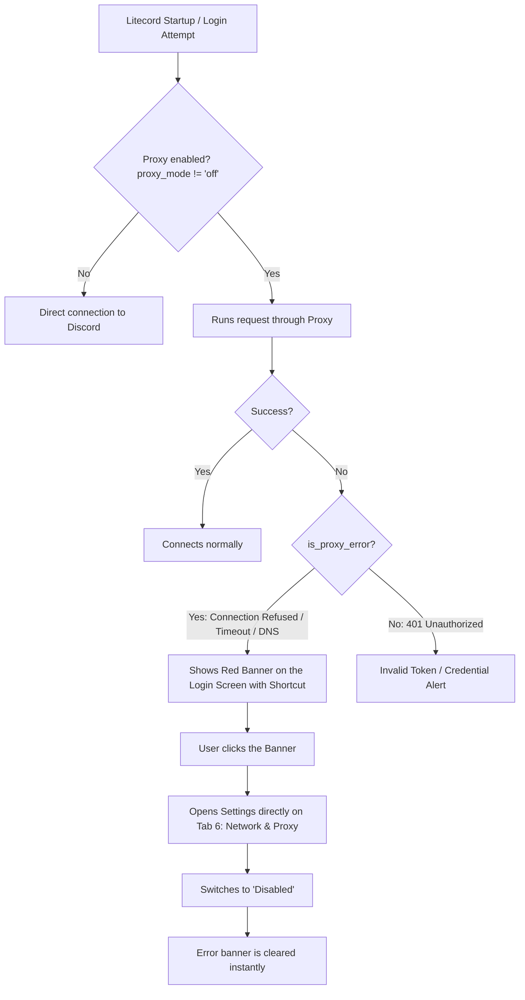

# 🌐 Litecord Network & Proxy Architecture

This documentation details the architecture, data models, traffic flow and error handling of Litecord's **Network and Proxy** system.

---

## 📑 Table of Contents
1. [Overview](#-overview)
2. [Models and Data Structure](#-models-and-data-structure)
3. [Supported Connection Modes](#-supported-connection-modes)
4. [Backend Routing (Rust)](#-backend-routing-rust)
5. [Login Screen Failure Protection and Diagnostics System](#-login-screen-failure-protection-and-diagnostics-system)
6. [Local Testing Tool (`scripts/test_proxy_server.py`)](#-local-testing-tool)
7. [Integration with VPNs and Mesh Networks (Tailscale, WireGuard)](#-integration-with-vpns-and-mesh-networks)

---

## 🚀 Overview

Litecord was designed to operate with minimal latency and maximum connection reliability, even in severely restricted network scenarios such as:
- Corporate and school networks that block Discord ports.
- Providers with government blocking or traffic censorship.
- Users who need IP isolation and anonymization via SOCKS5/Tor/Shadowsocks/V2Ray.

Unlike the official Electron client (which depends on system environment variables and Chromium), Litecord implements a **native network engine in Rust** with granular per-session control, support for multiple proxy types and reloading without restarting the application.

---

## 🗄️ Models and Data Structure

### 1. Local Persistence File
Network settings are saved in JSON format in the `.litecord_network_settings.json` file at the root of the executable:

```json
{
  "proxy_mode": "off",
  "proxy_host": "127.0.0.1",
  "proxy_port": 8080,
  "proxy_username": "",
  "proxy_password": "",
  "route_media": false
}
```

### 2. Rust Structure (`NetworkSettings`)
In the `src/utils/network_settings.rs` module:

```rust
#[derive(Debug, Clone, Serialize, Deserialize)]
pub struct NetworkSettings {
    pub proxy_mode: String,       // "off", "http", "socks5", "system"
    pub proxy_host: String,       // E.g.: "127.0.0.1" or "proxy.company.com"
    pub proxy_port: u16,          // E.g.: 8080, 1080
    pub proxy_username: String,   // Optional authentication (Basic Auth)
    pub proxy_password: String,   // Optional password
    pub route_media: bool,        // Selective routing of heavy media
}
```

* **Thread-Safety:** The in-memory configuration is kept under a global static `Mutex<NetworkSettings>`, accessible through the functions `get_network_settings()`, `save_network_settings()` and `update_network_settings()`.

---

## 🔌 Supported Connection Modes

| Mode | Identifier | Supported Protocols | Typical Use Case |
| :--- | :--- | :--- | :--- |
| **Disabled** | `"off"` | Direct TCP/UDP connection | Default. Bypasses any environment proxy (`no_proxy`). |
| **HTTP / HTTPS Proxy** | `"http"` | TCP (CONNECT Tunneling) | Enterprise networks, corporate firewalls, Fiddler, Burp Suite. |
| **SOCKS5 Proxy** | `"socks5"` | TCP and UDP | Shadowsocks, V2Ray, Xray, Tor (`127.0.0.1:9050`), anonymous routing. |
| **System Proxy** | `"system"` | Depends on the OS | Respects the `HTTP_PROXY` / `HTTPS_PROXY` / `ALL_PROXY` environment variables. |

---

## ⚙️ Backend Routing (Rust)

### 1. Proxy Injection into the HTTP Client (`apply_proxy_to_builder`)
Every REST HTTP request (`https://discord.com/api/v10/...`) goes through the centralized builder:

```rust
pub fn apply_proxy_to_builder(mut builder: reqwest::ClientBuilder) -> reqwest::ClientBuilder {
    let settings = get_network_settings();
    match settings.proxy_mode.as_str() {
        "http" | "https" => {
            let url = format!("http://{}:{}", settings.proxy_host.trim(), settings.proxy_port);
            if let Ok(mut p) = reqwest::Proxy::all(&url) {
                if !settings.proxy_username.is_empty() {
                    p = p.basic_auth(&settings.proxy_username, &settings.proxy_password);
                }
                builder = builder.proxy(p);
            }
        }
        "socks5" => {
            let url = format!("socks5://{}:{}", settings.proxy_host.trim(), settings.proxy_port);
            if let Ok(mut p) = reqwest::Proxy::all(&url) {
                if !settings.proxy_username.is_empty() {
                    p = p.basic_auth(&settings.proxy_username, &settings.proxy_password);
                }
                builder = builder.proxy(p);
            }
        }
        "system" => { /* Uses system variables */ }
        _ => { builder = builder.no_proxy(); }
    }
    builder
}
```

### 2. Real-Time Reload (Zero Downtime)
When clicking **"Save Settings"** in the interface, the `on_save_proxy_settings` callback in `src/main.rs`:
1. Saves the JSON settings file.
2. Rebuilds the `DiscordHttpClient` instance with the new parameters without dropping the active session or restarting the process.
3. If the proxy is disabled (`mode == "off"`), immediately clears any pending error alert in the interface.

### 3. Connection Test with Latency Diagnostics
The `test_proxy_connection()` function fires an asynchronous `GET` to `https://discord.com/api/v10/gateway` with a 6-second timeout:
- Times the real round-trip latency (`Instant::now().elapsed()`).
- Returns the HTTP code and time in milliseconds to the UI (shown in the green box).
- On failure, captures the original operating system error (e.g. error `10061` on Windows or `111` on Linux) and formats a clear message.

---

## 🛡️ Login Screen Failure Protection and Diagnostics System

One of the biggest problems faced by proxy users is opening the application with the configured proxy turned off, which used to block login without a clear explanation.

Litecord solves this with a triple detection system:



### Main Banner UI Features:
* **Dynamic Responsiveness:** Elastic height (`min-height: 38px`) and word wrapping (`wrap: word-wrap`) so detailed error messages are never cut off.
* **1-Click Action:** Clicking anywhere on the banner opens the settings window instantly on the **Network & Proxy** tab (`settings_active_tab = 6`).
* **Global Access from the Title Bar:** The gear icon ⚙️ in the application title bar remains accessible even on the signed-out login screen.

---

## 🧪 Local Testing Tool

For developers and local testing, the project includes a complete HTTP/HTTPS proxy server in Python:
[`scripts/test_proxy_server.py`](../scripts/test_proxy_server.py)

### How to run the test proxy:
```bash
python scripts/test_proxy_server.py
```
- Starts on port `127.0.0.1:8080`.
- Supports high-performance `CONNECT` tunnels with real-time logs of Discord traffic.
- In Litecord, select **HTTP / HTTPS Proxy**, enter `127.0.0.1:8080` and click **"Test Connection"**.

---

## 🔗 Integration with VPNs and Mesh Networks

* **Tailscale Exit Nodes:** If you use Tailscale on your computer with an Exit Node enabled, Litecord will operate in "Disabled" or "System Proxy" mode, using the virtual WireGuard interface automatically.
* **Tailscale Remote Nodes:** You can point Litecord at the Tailscale IP (`100.x.y.z`) of another machine on your private mesh that runs a proxy service (such as Dante SOCKS5 or Squid), getting end-to-end encryption without exposing ports to the public internet.
