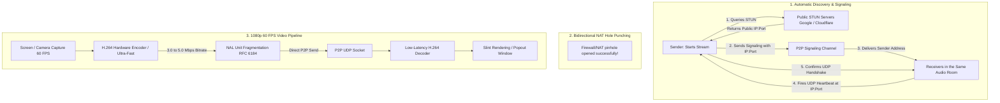

# Architecture Plan: 1080p 60 FPS P2P Video Streaming (Litecord)

This document describes the architecture, the technical diagnosis and the implementation plan for Litecord's own video streaming and screen sharing system, enabling **Full HD 1080p at 60 FPS** streams between any users connected to the same voice channel over the internet, with **zero dependency on Discord's video infrastructure**.

---

## 1. Diagnosis of the Current System (Why it does not work over the Internet at 1080p 60 FPS)

| Factor | Current Architecture (MJPEG / UDP Broadcast) | Impact / Root Cause |
| :--- | :--- | :--- |
| **Peer Discovery** | Sends to `255.255.255.255` and local subnets. | Routers and ISPs drop broadcast packets on the internet. The `register_remote_peer` method exists in the code, but is never called for lack of a signaling channel. |
| **Image Codec** | MJPEG (compression of complete JPEG photos in software). | Each frame weighs ~60 to 100 KB. At 60 FPS, this generates a constant **35 to 50 Mbps** of upload, unfeasible for normal home connections. |
| **UDP Fragmentation** | Frames split into ~60 UDP packets (MTU 1350). | At 60 FPS that is ~3,600 packets/s. If **a single packet** is lost on the internet route, the whole frame is discarded, producing a gray screen or freezing. |
| **CPU Usage** | Software `jpeg_encoder` on the CPU. | Takes 15ms to 25ms per frame at 1080p. The time limit for 60 FPS is **16.6ms**, forcing a safety cap at 30 FPS in the code. |

---

## 2. Overview of the New Architecture

---

## 3. The 4 Stages of the Implementation Plan

### Stage 1: Signaling and NAT Traversal
- **Public IP Discovery:** Use the public STUN servers already integrated (`stun.l.google.com:19302`, `stun.cloudflare.com:3478`) to obtain the `Public_IP:UDP_Port` pair.
- **Zero-Cost Signaling Channel:** Transmit `LTP_P2P:{user_id}:{ip}:{port}` connection metadata to all clients connected to the active voice channel.
- **Registration and Handshake:** Automatically call `register_remote_peer(uid, addr)` and fire a two-way UDP handshake to punch through residential NATs and firewalls.

---

### Stage 2: Migration from MJPEG to the H.264 Codec
- **Temporal Compression (I-Frames and P-Frames):** Only the pixels that changed between frames are transmitted.
- **Performance Comparison:**
  - **1080p 60 FPS Bitrate:** Drops from **45 Mbps** to **3.5 ~ 5.0 Mbps**.
  - **UDP Packets:** Drops from **3,600 packets/s** to **~180 to 300 packets/s**.
  - **Encoding Time:** Drops from **20 ms** to **1.5 ~ 4 ms** with hardware (GPU) acceleration or the *zerolatency* profile.
- **Cross-Platform Support:**
  - **Windows:** Media Foundation H.264 Hardware Encoder (NVENC / AMF / Intel QSV) with fallback to `openh264`.
  - **Linux:** Native GStreamer pipeline (`vaapih264enc` / `x264enc tune=zerolatency speed-preset=ultrafast`).

---

### Stage 3: Resilient Transport and Fast Recovery (PLI / Keyframe on Demand)
- **NAL Fragmentation (RFC 6184):** Compact P-frames are sent in just 1 or 2 UDP packets.
- **Picture Loss Indication (PLI):**
  - If a receiver joins mid-stream or packets are lost, the receiver sends a 1-byte packet: `OP_KEYFRAME_REQUEST`.
  - The sender forces the immediate emission of a Keyframe (I-Frame), restoring the receiver's video in under **30 ms**.

---

### Stage 4: UI Unlocking and Optimization
- **Removal of Limiters:** Unlock the 30 FPS limiter present in the capture code, enabling real 60 FPS at 1080p.
- **Zero-Copy Buffer:** Share the decoded frame directly with the Slint viewing component and with the detached window (*Popout*).

---

## 4. Execution Order

1. **Phase 1:** Implement the signaling channel and automatic registration of peers over the internet.
2. **Phase 2:** Integrate the low-latency H.264 encoder and decoder to replace JPEG.
3. **Phase 3:** Implement the `OP_KEYFRAME_REQUEST` mechanism and unlock 1080p 60 FPS in the interface.
